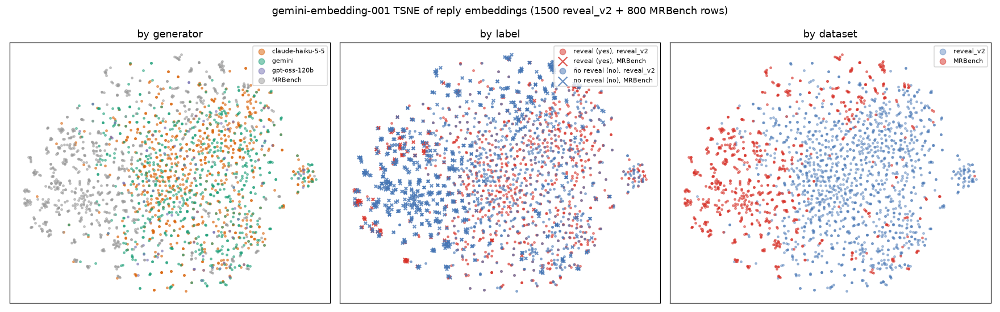

# Embedding audit of reveal_v2

## Question

Do the tutor replies in our training data cluster by things that should not matter (which
model wrote them, where the context came from) more than by what should (does the reply
reveal the answer)? And does what an embedding classifier learns on our data transfer to
the human-labelled benchmark MRBench? This is the semantic counterpart of
`shortcut_audit.py`, which only sees words (generator AUC 0.99, bag-of-words label AUC
0.917 inside reveal_v2 but 0.751 on MRBench).

## Data

Embedded text is the tutor reply (`response`) only.

- `data/reveal_v2.jsonl`: 5,858 rows, train 5,028 / val 830 (split by problem). Generators:
  claude-haiku-5-5 2,766, gemini 2,766, gpt-oss-120b 326. 1,732 rows are minimal pairs.
- `data/gsm8k.jsonl` (v1): 5,230 rows, one generator (gemini), train 4,706 / val 524.
- `data/mrbench.jsonl`: 1,655 labelled rows (266 yes), MathDial 1,160 and Bridge 495.
  Evaluation target only, never fitted on.

12,689 unique reply texts in total.

## Models

| name in `config.EMBEDDERS` | model | notes |
|---|---|---|
| gemini-embedding-001 | `gemini/gemini-embedding-001` (API version 001) | via `litellm.embedding`, 768 dims |
| gemini-embedding-2 | `gemini/gemini-embedding-2` (API version 2) | via `litellm.embedding`, 768 dims |
| minilm | `sentence-transformers/all-MiniLM-L6-v2` | local, 384 dims |
| bge-small | `BAAI/bge-small-en-v1.5` | local, 384 dims |

The Gemini models list endpoint offers exactly three embedding models:
`gemini-embedding-001`, `gemini-embedding-2` and `gemini-embedding-2-preview`. The preview
is skipped because `gemini-embedding-2` is the released version. Gemini vectors are cut to
768 dims (Matryoshka) and all vectors are L2-normalised. Library versions:
sentence-transformers 6.2.0, scikit-learn 1.9.1, numpy 2.5.4, matplotlib 3.11.2.

## Method

- Probe: standardise, then logistic regression (C=0.05, balanced class weights), the same
  setting everywhere. AUC from out-of-fold scores, 5-fold CV grouped by `problem_id`.
- Generator = claude-haiku-5-5 vs gemini rows only (gpt-oss-120b left out, 326 rows).
  "In yes" and "in no" repeat the generator probe on reveal rows only and guide rows only,
  so it is not label leaking through.
- Transfer: fit on the train split, report AUC on val and on MRBench (all, and by source).
  Same for v1.
- Silhouette: cosine, full data. Near 0 means no cluster structure along that variable.
- Domain gap: probe separating reveal_v2 from MRBench (grouped CV; MRBench grouped by
  conversation). Nearest-neighbour cosine: mean over MRBench rows of the best cosine to a
  random 1,655-row subset of reveal_v2, against the best cosine to another MRBench
  conversation. Same pool size on both sides.
- Pairs: mean cosine between the guide and reveal of the same context, for minimal pairs and
  free contexts, with the guide against a random other reveal as a floor.

## Results

AUC unless noted (0.5 = no signal). Full numbers in `*.json` next to this file.

| metric | minilm | bge-small | gemini-embedding-001 | gemini-embedding-2 |
|---|---|---|---|---|
| label, CV in reveal_v2 | 0.887 | 0.892 | 0.947 | 0.948 |
| generator, CV | 0.909 | 0.907 | 0.974 | 0.964 |
| generator, yes rows only | 0.882 | 0.877 | 0.967 | 0.955 |
| generator, no rows only | 0.927 | 0.936 | 0.980 | 0.974 |
| context_source, CV | 0.659 | 0.665 | 0.724 | 0.733 |
| v2 fit, AUC on v2 val | 0.873 | 0.891 | 0.953 | 0.941 |
| v2 fit, AUC on MRBench all | 0.705 | 0.772 | 0.783 | 0.859 |
| v2 fit, MRBench MathDial | 0.830 | 0.841 | 0.918 | 0.896 |
| v2 fit, MRBench Bridge | 0.711 | 0.790 | 0.795 | 0.822 |
| v1 fit, AUC on MRBench all | 0.707 | 0.763 | 0.769 | 0.782 |
| v1 fit, MRBench MathDial | 0.852 | 0.856 | 0.924 | 0.877 |
| v1 fit, MRBench Bridge | 0.767 | 0.823 | 0.820 | 0.779 |
| silhouette, label | 0.006 | 0.010 | 0.008 | 0.011 |
| silhouette, generator | 0.006 | 0.008 | 0.010 | 0.014 |
| silhouette, context_source | 0.003 | 0.001 | 0.005 | 0.004 |
| domain probe, v2 vs MRBench | 0.942 | 0.953 | 0.987 | 0.987 |
| NN cosine, MRBench to v2 | 0.541 | 0.751 | 0.718 | 0.772 |
| NN cosine, MRBench to MRBench | 0.662 | 0.817 | 0.796 | 0.840 |
| pair cosine, minimal pairs | 0.889 | 0.937 | 0.923 | 0.939 |
| pair cosine, free contexts | 0.691 | 0.804 | 0.814 | 0.840 |
| guide vs random reveal (floor, free contexts) | 0.260 | 0.574 | 0.601 | 0.654 |

Plots (PCA and t-SNE, 1,500 reveal_v2 rows plus 800 MRBench rows, coloured by generator,
label and dataset), one pair per model:
`minilm_pca.png`, `minilm_tsne.png`, `bge-small_pca.png`, `bge-small_tsne.png`,
`gemini-embedding-001_pca.png`, `gemini-embedding-001_tsne.png`,
`gemini-embedding-2_pca.png`, `gemini-embedding-2_tsne.png`.



## Interpretation

- The generator is as easy to read from the embedding as the label, and a bit easier for
  every model (0.91 to 0.97 against 0.89 to 0.95). It survives inside a single label
  (0.88 to 0.98), so it is real style, not the label leaking. A judge trained on this data
  can learn "sounds like Claude" or "sounds like Gemini" for free, and the label probe has
  no way to tell that apart from reveal behaviour. Context source is much weaker (0.66 to
  0.73) but still above chance.
- Silhouette is about 0.01 for label, generator and source alike. Nothing forms tight
  clusters by any of them. The signal is a direction a linear probe finds, not a visible
  blob, and the plots agree: generators overlap heavily.
- Label transfer is real but lower than inside the data: 0.94 to 0.95 on v2 val for the
  Gemini models, 0.71 to 0.86 on all of MRBench. gemini-embedding-2 transfers best (0.859).
  MathDial rows transfer well (0.83 to 0.92), Bridge less so (0.71 to 0.82). The MRBench
  total is below both slices for most models because the two sources sit at different score
  levels, so a single ranking over both mixes them. Do not read the total as
  the average of the slices.
- v1 versus v2: on all of MRBench v2 is better for gemini-embedding-2 (0.859 against 0.782)
  and bge-small (0.772 against 0.763), about equal for gemini-embedding-001, and the same for
  minilm. On the slices it is mixed, v1 is higher on MathDial for three models and on
  Bridge for three. So the embedding view does not show v2 clearly beating v1 on transfer. The
  word-level gap (v1 near perfect shortcuts) is not visible here because v1 and v2 both
  give a probe that reads style.
- Domain gap is large. A probe separates reveal_v2 from MRBench at 0.94 to 0.99. MRBench rows
  sit closer to other MRBench rows than to reveal_v2 for every model (for example 0.84 against
  0.77 for gemini-embedding-2). The generated replies do not look like the benchmark replies,
  so transfer numbers are partly a measure of how much of the label signal is style shared by
  both.
- Minimal pairs are very close (cosine 0.89 to 0.94) while free guide and reveal replies of
  the same context sit at 0.69 to 0.84, against a floor of 0.26 to 0.65. Pairs are close
  in embedding space as designed, and the label difference that remains inside a pair is
  small relative to the shared wording. Worth keeping in mind: a probe trained on pairs has to
  find the label in a small residual. MiniLM has a low floor because its space is spread
  out, so compare floors and values within a model, not across.

## Limits

- Response-only embeddings. Conversation plus response was not run.
- One probe setting (C=0.05) for every task, not tuned per task. One seed for the CV split
  and the plot subsample.
- Gemini vectors cut to 768 dims. The 3072 default was not tried.
- Probe AUCs are single numbers without confidence intervals. MRBench Bridge has 495 rows
  and a small yes share, so differences of a few points on slices are within noise.
- gpt-oss-120b rows are in the label and context-source probes but not the generator probe.

## Cost

Gemini: 701,702 prompt tokens per model as reported by the API, 12,689 texts, two models.
At list prices (about $0.15 per million tokens for gemini-embedding-001, price of
gemini-embedding-2 not checked and assumed similar or lower than $0.30) the total is
well under $0.50, roughly $0.15 to $0.35. Not read from a billing page. Local models cost
nothing. Cached vectors are in `runs/embed/` (git-ignored), so reruns cost nothing.

## Reproduce

```bash
uv sync --extra embed
uv run embed_audit.py --selftest
uv run embed_audit.py --model gemini-embedding-001 & uv run embed_audit.py --model gemini-embedding-2 & \
  uv run embed_audit.py --model minilm & uv run embed_audit.py --model bge-small & wait
uv run embed_audit.py --table     # markdown table from results/embed-audit/*.json
```
